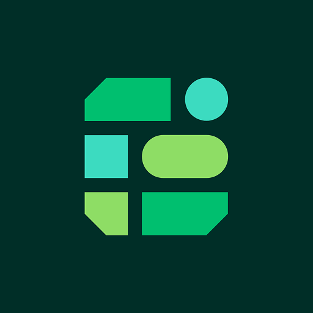

# Commerce Engine MCP connector



Connect your AI app to your Commerce Engine store. Work on products, categories,
inventory, media, coupons, promotions, sales channels and marketplaces, and search
and read orders using your own account and permissions.

```text
https://mcp.commercengine.io/mcp
```

This repository packages the **hosted** connector. It does not run a local server
or contain the server implementation. You need a Commerce Engine admin account
with access to a store and a client supporting Streamable HTTP and OAuth.

Sign in with your usual Commerce Engine login and approve the consent page.
No API key, client secret or custom header is needed. The server supports OAuth
2.1 discovery, PKCE, Client ID Metadata Documents and dynamic client registration
with scope `ce`.

## Install

Choose one method per client to avoid duplicate connections. Repository-based
commands below become available once this repository is published at
`github.com/commercengine/mcp`. This package has not been submitted to a public
plugin directory or the MCP Registry; the direct server URL works independently
of directory listings.

### claude.ai and Claude Desktop

Open **Customize → Connectors → Add custom connector**, name it **Commerce
Engine**, and enter the server URL above. Select **Connect**, sign in, and approve
the connection. Enable it in the chat's connectors menu.

For Team or Enterprise, an owner first adds it in **Organization settings →
Connectors**; each member then connects with their own account.
See [Claude's custom connector guide](https://support.claude.com/en/articles/11175166-get-started-with-custom-connectors-using-remote-mcp).

### ChatGPT

Open **Plugins → + → Add custom MCP server**. Enter **Commerce Engine** and the
server URL, select OAuth, review the warning, and choose **Create as a plugin**.
Complete Commerce Engine sign-in and consent, then install it from your personal
plugins. Start a Work chat and select Commerce Engine with `@`. Workspace policy
may require an administrator to enable custom servers.

The root Agent Plugins package is also prepared for ChatGPT/Codex distribution;
it is not yet a public-directory listing. See [OpenAI's connection and packaging
guide](https://developers.openai.com/plugins/build/plugins#create-and-test-a-plugin-locally-with-an-mcp-server).

### Codex

Install from this repository's marketplace after publication:

```bash
codex plugin marketplace add commercengine/mcp
codex plugin add commerce-engine@commerce-engine
```

Start a new session and complete the plugin's OAuth connection flow. For local
package testing, replace the first command's repository with the absolute path
to your checkout.

Alternatively, connect the hosted server directly:

```bash
codex mcp add commerce-engine --url https://mcp.commercengine.io/mcp
codex mcp login commerce-engine
```

The second command opens sign-in if it has not already completed. See
[Codex marketplace commands](https://developers.openai.com/plugins/build/plugins#add-a-marketplace-from-the-cli)
and [Codex MCP](https://developers.openai.com/codex/mcp).

### Claude Code

Install the plugin after repository publication:

```bash
claude plugin marketplace add commercengine/mcp
claude plugin install commerce-engine@commerce-engine
```

Restart Claude Code, run `/mcp`, select the Commerce Engine server and choose
**Authenticate**. A local checkout path also works with `plugin marketplace add`.

Alternatively, add the server directly:

```bash
claude mcp add --transport http commerce-engine https://mcp.commercengine.io/mcp
```

Then authenticate from `/mcp`. See [Claude Code marketplaces](https://code.claude.com/docs/en/plugin-marketplaces)
and [MCP connections](https://code.claude.com/docs/en/mcp).

### Cursor

Cursor supports root Agent Plugins manifests and `mcp.json`. The additional
`.cursor-plugin/plugin.json` supplies Cursor's logo metadata. A future approved
listing can be installed from **Customize**; no public listing exists yet.

To connect now, merge this entry into your project's `.cursor/mcp.json` or your
user-level `~/.cursor/mcp.json`:

```json
{
  "mcpServers": {
    "commerce-engine": {
      "url": "https://mcp.commercengine.io/mcp"
    }
  }
}
```

Open Cursor's MCP settings and complete the server's OAuth sign-in. See
[Cursor MCP](https://cursor.com/docs/context/mcp) and the
[plugin format reference](https://cursor.com/docs/reference/plugins).

### VS Code

Run **MCP: Add Server** in the Command Palette, choose HTTP, enter the server URL
and name it `commerce-engine`. Choose your desired configuration scope and
complete OAuth sign-in when prompted.

For workspace configuration, merge into `.vscode/mcp.json`:

```json
{
  "servers": {
    "commerce-engine": {
      "type": "http",
      "url": "https://mcp.commercengine.io/mcp"
    }
  }
}
```

VS Code uses `servers`, rather than the portable package's `mcpServers` key.
See [adding MCP servers](https://code.visualstudio.com/docs/agent-customization/mcp-servers)
and the [configuration reference](https://code.visualstudio.com/docs/agents/reference/mcp-configuration).

### Gemini CLI

After repository publication:

```bash
gemini extensions install https://github.com/commercengine/mcp
```

Restart Gemini CLI and run `/mcp auth commerce-engine` to sign in. For local
testing, `gemini extensions install /absolute/path/to/checkout` installs a copy.
The extension uses Gemini's `httpUrl` property for Streamable HTTP and lets the
client discover OAuth settings. See [extensions](https://geminicli.com/docs/extensions/reference/)
and [MCP authentication](https://geminicli.com/docs/tools/mcp-server/#oauth-support-for-remote-mcp-servers).

### Any other MCP client

Add a remote Streamable HTTP server with the URL above and enable OAuth discovery.
The client must support interactive OAuth sign-in and CIMD or dynamic client
registration. Clients accepting only stdio servers or fixed API keys cannot
connect directly.

Discovery metadata:

- Protected resource: `https://mcp.commercengine.io/.well-known/oauth-protected-resource/mcp`
- Authorization server: `https://mcp.commercengine.io/.well-known/oauth-authorization-server`

## Sandbox and Live

New connections start in **Sandbox**. Ask which environment and stores the app can
reach before working. Sandbox and Live stores are separate; their IDs do not
carry across environments.

To change environment, ask the app to switch. It returns a link to Commerce
Engine's admin app, where **you** approve the switch. The change applies to every
chat using that connection. The agent cannot switch to Live by itself.

**Sales channels and marketplace sellers are organisation-wide. Changes to them
affect Live even while the connection is in Sandbox.**

Review tool approvals before making changes. Tools describe read/write and
destructive behavior, but the client controls how it presents approvals. Avoid
blanket approval for updates, deletes, publishing and syncing in Live.

## Try it

- “Which environment are you in, and which stores can you reach?”
- “Find the Linen Shirt and show me its description.”
- “Create a category called Accessories under Men.”
- “Find the WELCOME10 coupon.”
- “Show me the most recent orders.”
- “List the sellers waiting for approval on my marketplace.”

The connector can read orders, but cannot cancel, refund or edit them. It can
find customers, but cannot edit them. Payment, store-setting, user and role
changes belong in the admin app. Marketplace channels are set up in the admin app
too, because they need the marketplace's API credentials, which never pass
through a chat. The connector doesn't create images itself. If your AI app makes
one, the connector can upload it from a public link or, in apps that can run
commands such as Claude Code and Codex, from a file.

## Privacy, help and disconnecting

The connector acts with your permissions. Your AI provider receives tool results,
which can include customer details in orders. Review the
[privacy policy](https://www.commercengine.io/privacy-policy) and
[terms](https://www.commercengine.io/terms-of-use).

Remove the plugin or server in your client's settings to disconnect. For a direct
CLI connection, use `codex mcp remove commerce-engine` or
`claude mcp remove commerce-engine`. For the packaged plugin, uninstall it from
that client's plugin manager instead.

- [Connector documentation](https://www.commercengine.io/docs/ai/mcp-connector)
- [Contact support](https://www.commercengine.io/contact-us) · support@commercengine.io

## Maintainers

Keep the version, identity and endpoint consistent across the manifests. There is
intentionally no root `.mcp.json`: Claude Code declares its HTTP server inline,
so Cursor cannot shadow the portable `mcp.json` with a legacy file.

Validate with Python 3 and `jsonschema` (the example uses an isolated uv environment):

```bash
uv run --with jsonschema==4.23.0 python scripts/validate.py
claude plugin validate .
claude plugin validate .claude-plugin/plugin.json
```

The schema check downloads the versioned official Agent Plugins and MCP Registry
schemas. It also checks packaging consistency and the local Plugin Creator
checklist; it does not perform a portal scan or OAuth acceptance test.

Build an OpenAI-only draft archive outside the checkout:

```bash
python3 scripts/package.py /tmp/commerce-engine-0.1.0.zip
uv run --with jsonschema==4.23.0 python scripts/validate.py --archive /tmp/commerce-engine-0.1.0.zip
```

The archive excludes marketplaces and other clients' manifests. Packaging never
uploads or publishes anything; submission happens in OpenAI's plugin portal.

There is a current format conflict: OpenAI documents a server-level OAuth
extension that the published Agent Plugins 1.0.0 MCP schema rejects. The root
`mcp.json` therefore uses client-managed OAuth discovery without that extension.
The packaging script adds `extensions.com.openai.auth` only to the OpenAI draft
ZIP, with CIMD preference and scope `ce`. Archive validation reports this known
schema exception rather than claiming that the OpenAI-specific file is portable.

Licensed under [MIT](LICENSE), matching the license declared by
[Commerce Engine Skills](https://github.com/commercengine/skills#license).
